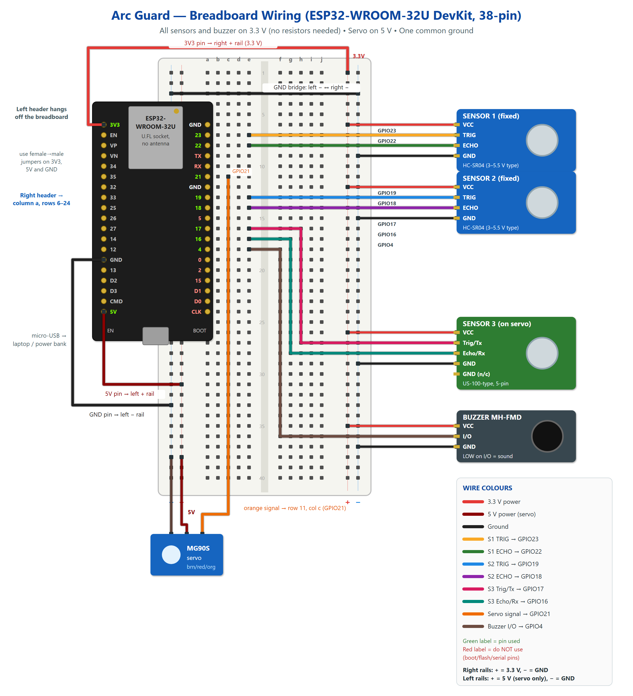
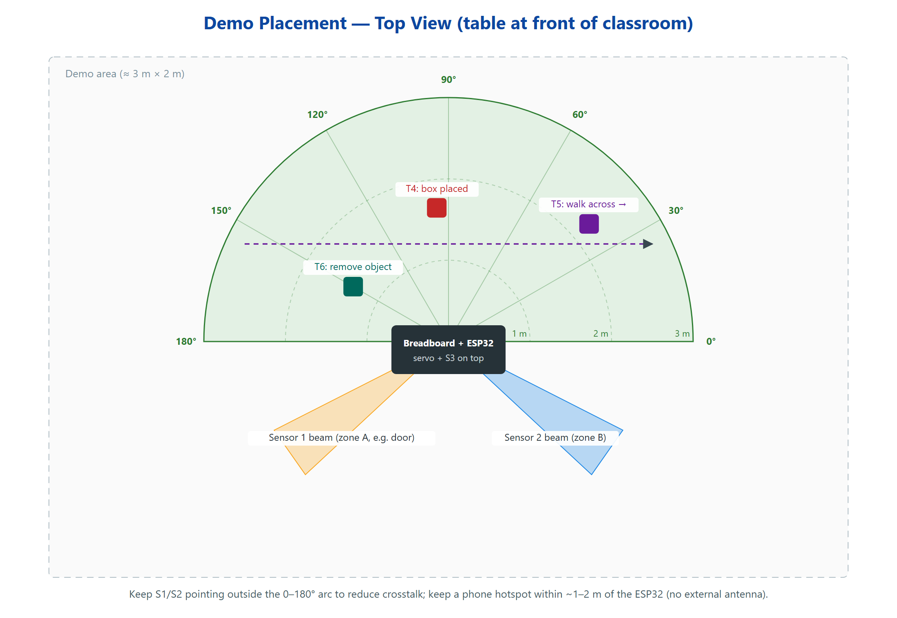

# Wiring — Arc Guard

## Pin map

| Function | ESP32 pin | Breadboard row (column a) | Wire colour (suggested) |
|---|---|---|---|
| Sensor 1 TRIG | GPIO23 | 7 | yellow |
| Sensor 1 ECHO | GPIO22 | 8 | green |
| Servo signal (orange) | GPIO21 | 11 | orange |
| Sensor 2 TRIG | GPIO19 | 13 | blue |
| Sensor 2 ECHO | GPIO18 | 14 | purple |
| Sensor 3 Trig/Tx | GPIO17 | 16 | pink |
| Sensor 3 Echo/Rx | GPIO16 | 17 | teal |
| Buzzer I/O | GPIO4 | 18 | brown |
| Sensors + buzzer VCC | **3V3** pin (left header, top) | right **+** rail | red |
| Servo VCC (red) | **5V** pin (left header, bottom) | left **+** rail | dark red |
| All GND | GND pins | both **−** rails, bridged | black |

Pins deliberately **not** used: GPIO 6–11 (CLK, D0–D3, CMD — internal flash), GPIO 0/2/5/15 (boot-strapping), GPIO 1/3 (TX/RX — USB serial).

## Why no resistors are needed

The classic HC-SR04 is a 5 V part whose ECHO output swings to 5 V, which can damage the ESP32 (inputs are rated to 3.6 V). Your two HC-SR04 boards are the newer 3–5.5 V version and the US-100-type module runs from 2.4–5.5 V. Powered from **3.3 V**, their ECHO outputs can never exceed 3.3 V, so they connect directly to the ESP32.

> Never connect a sensor VCC to the 5 V rail. Check this with a multimeter before plugging in USB.

## Step by step

1. Push the ESP32's **right-hand** header (the one starting `GND 23 22 TX RX…`) into **column a, rows 6–24**, antenna end towards row 1. The left header hangs off the breadboard edge — the board is too wide for both rows to fit.
2. **3.3 V rail:** female-to-male jumper from the **3V3** pin (left header, top) to the **right + rail**.
3. **5 V rail:** female-to-male jumper from the **5V** pin (left header, bottom) to the **left + rail**. Only the servo uses this rail.
4. **Ground:** female-to-male jumper from a left-header **GND** to the **left − rail**; then a jumper from the left − rail to the **right − rail** (row 3) so both are the same ground.
5. **Sensor 1:** VCC → right + rail, GND → right − rail, TRIG → row 7 (col b–e), ECHO → row 8.
6. **Sensor 2:** VCC → right + rail, GND → right − rail, TRIG → row 13, ECHO → row 14.
7. **Sensor 3 (on the servo):** VCC → right + rail, either GND → right − rail, Trig/Tx → row 16, Echo/Rx → row 17. Use long, slack wires so they don't pull the sensor as it rotates.
8. **Servo:** brown → left − rail, red → left + rail (5 V), orange → row 11.
9. **Buzzer (MH-FMD):** VCC → right + rail (3.3 V), GND → right − rail, I/O → row 18.
10. Before connecting USB, check with a multimeter (continuity mode, unpowered): right + rail ↔ 3V3 pin = beep; right + rail ↔ 5V pin = **no** beep; both − rails ↔ GND = beep.

## US-100 jumper (Sensor 3)

The 5-pin module has a jumper on the back:

- **No jumper** → pulse mode (works exactly like an HC-SR04). This is the default the firmware expects.
- **Jumper fitted** → UART mode. Also supported: tick *Sensor 3 in UART mode* in the dashboard settings (the ESP32 restarts). The wiring stays the same.

## Physical placement for the demo

- Servo + Sensor 3 face the demo area; the sweep covers the front 0–180°.
- Point Sensors 1 and 2 **outside** the sweep arc (e.g. one at a door, one at a side zone) to reduce crosstalk.
- Tell the dashboard where they point: **Settings → Sensor placement** (0° = right, 90° = front, 180° = left, 270° = rear; the defaults 215° and 325° match the picture above). The room map then draws their beams in the right direction.
- Fix the servo body down (tape or a small board) so the sweep does not move the base.
- Keep the phone hotspot within 1–2 m of the ESP32 (no external antenna is fitted).
